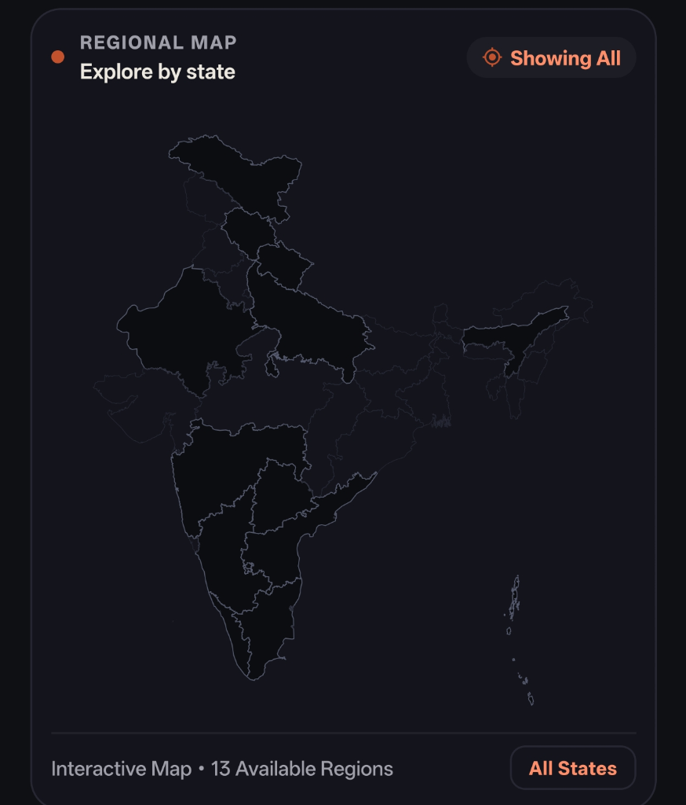
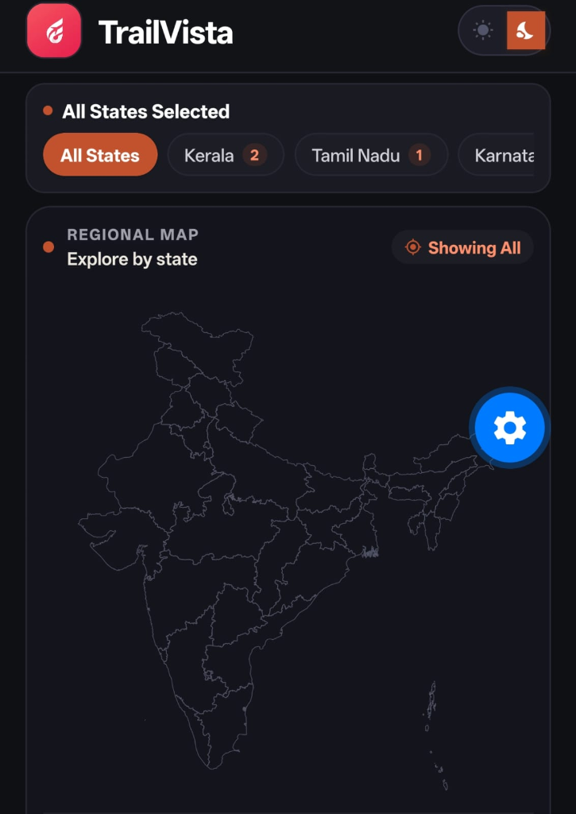
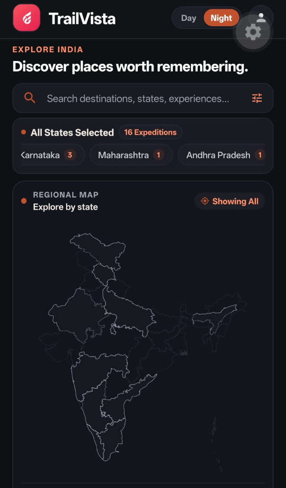

# TrailVista • India Journey Explorer

> **Boutique Travel Expedition Planner & Cultural Field Journal**  
> Built with React Native (Expo SDK 57), TypeScript, and a modern editorial design inspired by Indian heritage and geography.

[-C2512D?style=for-the-badge&logo=android&logoColor=white)](https://github.com/undefinedtrail/trailvista-travel-explorer/releases/latest/download/TrailVista.apk)
[](https://github.com/undefinedtrail/trailvista-travel-explorer/releases/latest)

---

### 📲 Instant Standalone Installation (No Dev Server Needed!)
You can install **TrailVista** directly onto your Android device without running any local dev servers or Expo Go:
- 🚀 **Direct APK Link**: [**Download TrailVista.apk (v1.0.1)**](https://github.com/undefinedtrail/trailvista-travel-explorer/releases/latest/download/TrailVista.apk)
- 📦 **Releases Page**: [**View GitHub Releases**](https://github.com/undefinedtrail/trailvista-travel-explorer/releases/latest)

> **Installation Note**: Tap the downloaded file and select **"Install"** (enable *"Install unknown apps"* in your Android browser settings if prompted).

---

## 🧭 Project Overview

**TrailVista** is a mobile application designed for travelers who appreciate thoughtful, immersive cultural expeditions across India. Rather than presenting generic travel lists, TrailVista treats each destination as a curated journey—from cobalt glacial lakes in Ladakh (14,000 ft) to the quiet, palm-fringed backwater lagoons of Kerala, the stone monoliths of Ellora, and the Nizami citadels of Telangana.

The application blends a contemplative dark-mode visual palette with real-world travel planning utilities: an accurate interactive regional vector SVG map, a dynamic multi-criteria travel matcher, day-by-day itineraries with full morning/afternoon/evening schedules, live weather telemetry, and seamless Google Maps routing.

---

## 📱 Screenshots

| Interactive Regional Map | Explore & Curated Expeditions |
| :---: | :---: |
|  |  |

| Smart Search & "Surprise Me" | Expedition Dossier & Details |
| :---: | :---: |
|  |  |

---

## ✨ Features

### 1. 🗺️ Geographically Accurate Interactive SVG Regional Map
* **Precise Vector SVG Map**: Pure vector state boundaries accurately representing all Indian states and union territories.
* **13 Available Interactive Regions**: Includes Kerala, Telangana, Andhra Pradesh, Tamil Nadu, Karnataka, Maharashtra, Rajasthan, Ladakh, Himachal Pradesh, Uttar Pradesh, Assam, Uttarakhand, and the Andaman & Nicobar Islands.
* **Interactive State Selection**: Tapping any available state fills its authentic geographic SVG boundary with an orange accent (`#E05A47`) while unavailable states remain subtle and crisp.
* **Regional Telemetry HUD**: Selecting any region instantly surfaces seasonal weather telemetry, best visiting months, local highlights, and filters the expedition feed.
* **Instant Reset View**: One-tap "All States" button returns to pan-India view with a smooth transition.

### 2. 🎯 Smart Destination Matcher ("Find My Trip")
* **Interactive Preferences**:
  * **Travel Style**: Mountains, Beach, Heritage, Adventure, Nature, Culture
  * **Travel Pace**: Relaxed (Scenic & Serene), Curated (Balanced Highlights), Immersive (Trails & Expeditions)
  * **Duration**: 1–2 days, 3–4 days, 5+ days
* **Dynamic Ranking Engine**: Calculates multi-weighted compatibility scores (e.g., *"Munnar — 96% Match"*, *"Pangong Tso — 94% Match"*) based on category correlation, tag semantics, exploration pace alignment, duration compatibility, and user rating.
* **Instant Navigation**: Tapping any ranked match card opens its comprehensive Details screen.

### 3. 🎲 "Surprise Me" Itinerary Discovery
* **One-Tap Serendipity**: In the Search tab, tap the **"Surprise Me"** button to randomly select a curated expedition across India with a smooth haptic feel.
* **Instant Deep Linking**: Directly transitions the traveler to the full expedition dossier of the selected destination.

### 4. 📍 Seamless Google Maps Navigation
* **Prominent Route Card**: Placed directly below the destination's Quick Facts on the Details screen.
* **Direct Point-to-Point Routing**: Opens destination coordinates and landmarks directly in Google Maps via React Native `Linking.openURL` without requiring heavyweight SDKs or billing keys.
* **Attraction Directions**: Every curated sight card contains a dedicated "Maps" link for point-to-point navigation.

### 5. ⛅ Live Weather Telemetry with Graceful Fallback
* **Real-Time Data**: Queries real-world temperatures, WMO weather condition codes, relative humidity, and wind speeds via Open-Meteo.
* **Zero Failure Rate**: Wrapped in strict timeout and error handlers—if offline or if network fails, it immediately falls back to verified seasonal weather data (`destination.weather`).
* **Environment Variable Support**: Supports optional OpenWeatherMap integration via `EXPO_PUBLIC_WEATHER_API_KEY`.

### 6. 📸 100% Visually Verified High-Resolution Photography
* **Curated Covers & Highlights**: Every single destination (17 total) and attraction (51 total) features authentic, high-resolution photography.
* **Authentic Heritage & Nature**:
  * **Telangana**: Charminar, Golconda Fort Citadel & UNESCO Ramappa Temple / Kakatiya Kala Thoranam.
  * **Rajasthan**: Jaisalmer Sonar Qila & Thar Desert camel caravans; Udaipur City Palace & Lake Pichola.
  * **Maharashtra**: Kailasa Temple Cave 16 monolith & Ajanta cliff canyon.
  * **Karnataka**: Hampi Vijaya Vittala Stone Chariot & Virupaksha Gopuram; Gokarna coastal Arabian Sea shrine; Coorg coffee plantations.
  * **Assam**: Indian one-horned rhinoceros in Kaziranga grasslands.
  * **Tamil Nadu**: Meenakshi Amman Temple Gopuram and sacred temple tank.
  * **Uttar Pradesh**: Dashashwamedh Ghat evening Ganga Aarti ceremony & dawn boatmen.
  * **Uttarakhand**: Grade IV white-water rafting in Rishikesh Ganga Gorge.
  * **Andaman**: Radhanagar Beach white sands and turquoise waters.

### 7. 🌓 Futuristic Theme Toggle & Edge-Swipe Navigation
* **Futuristic Circular Sun/Moon Toggle**: Smooth toggle between obsidian dark theme and warm parchment light theme.
* **System Edge-Swipe Back Gesture**: Native swipe-to-go-back gesture enabled throughout all screen stacks.
* **Wishlist Bookmarker**: Save dream expeditions locally with instant sync across tabs.

---

## 🛠️ Tech Stack & Architecture

* **Framework**: React Native 0.83 / Expo SDK 57 (New Architecture enabled)
* **Language**: TypeScript 5.9+ (Strict Mode)
* **Vector Graphics**: `react-native-svg` (Clean path geometry & viewboxes)
* **Navigation**: React Navigation (Native Stack with fluid gesture handlers)
* **Icons**: `@expo/vector-icons` (MaterialIcons & Ionicons)
* **State Management**: React Hooks & Context API (`ThemeContext`, `WishlistContext`)
* **Styling**: Modern StyleSheet architecture with dynamic dark/light color tokens

---

## 🚀 Getting Started & Setup

### Prerequisites
* **Node.js**: v18.x or v20.x+ installed
* **Package Manager**: `npm` or `bun`
* **Mobile Testing**: Expo Go app on iOS or Android (or Xcode / Android Studio simulator)

### 1. Clone the Repository
```bash
git clone https://github.com/undefinedtrail/travel-explorer.git
cd travel-explorer
```

### 2. Install Dependencies
```bash
npm install
```

### 3. Start the Development Server
```bash
npx expo start
```

### 4. Run on Device
* **Android**: Press `a` in the terminal or scan the QR code with the Expo Go app.
* **iOS**: Press `i` in the terminal (macOS required) or scan the QR code with the Camera app.
* **Web**: Press `w` in the terminal to view in browser.

### 5. Typecheck & Verification
```bash
npx tsc --noEmit
```

---

## 📂 Project Directory Structure

```
├── assets/
│   ├── icon.png
│   ├── splash-icon.png
│   ├── yatra_logo.png
│   └── screenshots/              # App UI screenshots
├── src/
│   ├── components/               # UI components (DestinationCard, Header, etc.)
│   ├── constants/
│   │   ├── colors.ts             # Theme tokens (Dark & Light palettes)
│   │   └── mockData.ts           # Curated expeditions, states, and telemetry data
│   ├── context/
│   │   ├── ThemeContext.tsx      # Dark/Light mode theme provider
│   │   └── WishlistContext.tsx   # Local expedition bookmark state
│   ├── models/
│   │   └── Destination.ts        # TypeScript data interfaces & types
│   ├── navigation/
│   │   └── AppNavigator.tsx      # Bottom tabs & NativeStack navigation
│   ├── screens/
│   │   ├── HomeScreen.tsx        # Regional map & popular expeditions feed
│   │   ├── SearchScreen.tsx      # Filter, search & "Surprise Me" discovery
│   │   ├── SmartMatcherScreen.tsx# "Find My Trip" dynamic multi-criteria engine
│   │   ├── WishlistScreen.tsx    # Saved expeditions & quick access
│   │   └── DetailsScreen.tsx     # Full expedition dossier, weather & Google Maps
│   ├── services/
│   │   └── weatherService.ts     # Open-Meteo & OpenWeather integration
│   └── widgets/
│       ├── IndiaMapExplorer.tsx  # Interactive SVG India Map widget
│       └── StateTelemetryCard.tsx# Regional weather & season telemetry card
├── App.tsx                       # Root application entry point
├── app.json                      # Expo configuration & permissions
├── tsconfig.json                 # TypeScript compiler options
└── package.json                  # Dependencies & project scripts
```

---

## 📄 License
This project is developed for educational and exploratory travel purposes. All rights reserved.
