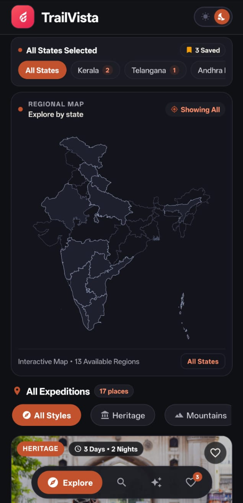
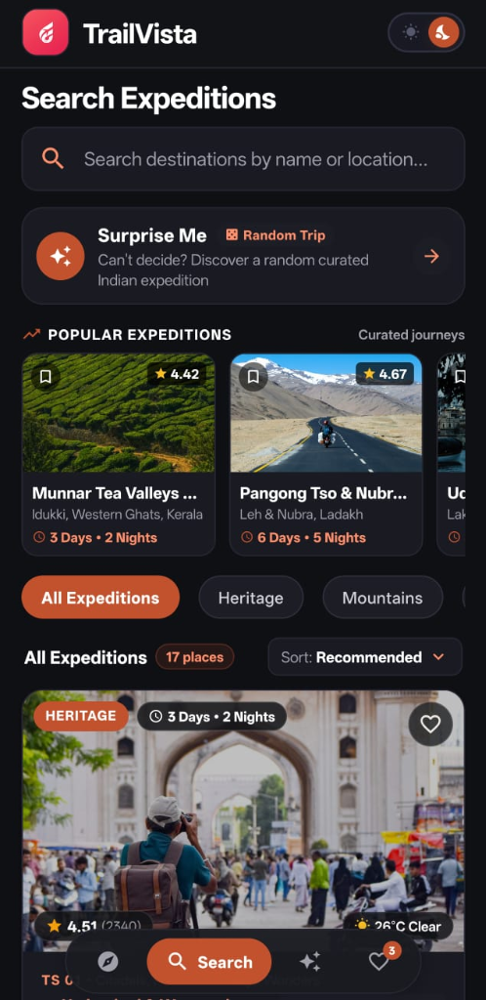
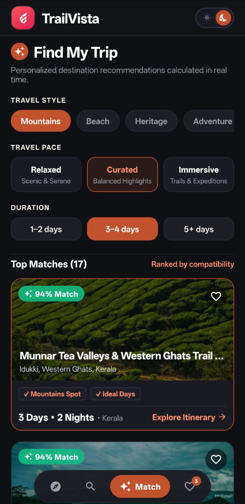
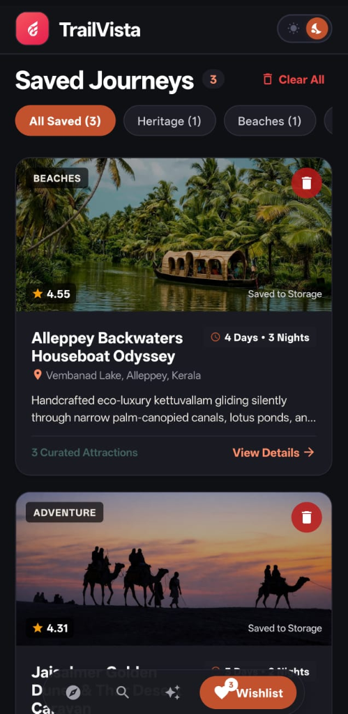
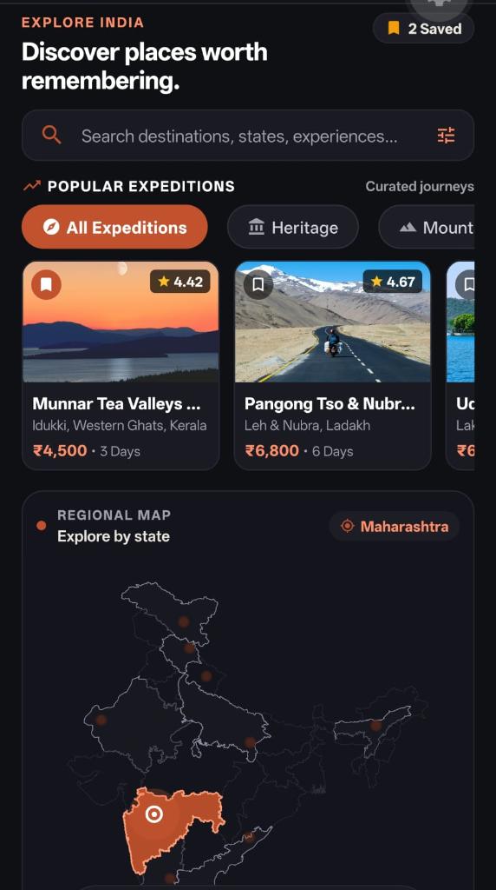

# TrailVista

[-E05A47?style=for-the-badge&logo=android&logoColor=white)](https://github.com/undefinedtrail/trailvista-travel-explorer/releases/latest/download/TrailVista.apk)
[](https://github.com/undefinedtrail/trailvista-travel-explorer/releases/latest)
[](https://expo.dev/)
[](https://www.typescriptlang.org/)

---

## Project Overview

**TrailVista** is a mobile travel exploration application developed using React Native and Expo. The application helps users discover curated travel destinations and cultural journeys across India through an interactive map, structured multi-criteria filtering, and comprehensive day-by-day itineraries. Designed for intuitive trip planning, TrailVista provides travelers with destination overviews, local attractions, live weather updates, and direct navigation links.

---

## Screenshots

| Explore & Interactive Map | Search & "Surprise Me" |
| :---: | :---: |
|  |  |
| *Interactive India SVG map with state details and destination list* | *Search with category filters, popular trips, and Surprise Me button* |

| Smart Destination Matcher | Saved Destinations |
| :---: | :---: |
|  |  |
| *Travel preference matching with real-time compatibility scores* | *Locally saved itineraries categorized for quick offline access* |

<div align="center">

### Destination Details & Navigation


*Detailed destination view with day-by-day itinerary, live weather conditions, and direct Google Maps routing*

</div>

---

## Features

- **Interactive India Map**: An interactive vector SVG map of India allowing users to select states and filter destinations by region.
- **State Information Card**: Displays regional seasonal recommendations, climate highlights, and destination counts for selected states.
- **Destination Cards**: Visual cards presenting essential destination details, imagery, duration, and ratings.
- **Search & Category Filtering**: Real-time search by destination name or location, accompanied by style-based filter chips.
- **Sorting Options**: Allows sorting expeditions by recommended order, user rating, and trip duration.
- **Surprise Me**: A one-tap feature in the search view that randomly selects and opens a curated itinerary.
- **Smart Destination Matcher**: Recommends destinations based on selected travel style, preferred pace, and trip duration with calculated percentage compatibility scores.
- **Destination Details & Key Attractions**: In-depth destination profiles detailing cultural background, best visiting season, and key local sights.
- **Day-Wise Itinerary**: Comprehensive day-by-day itineraries broken into morning, afternoon, and evening schedules.
- **Google Maps Navigation**: External integration that opens coordinates and points of interest directly in Google Maps for live route guidance.
- **Live Weather Updates**: Fetches current temperatures and conditions using the Open-Meteo API, with automatic fallback to seasonal data when offline.
- **Saved Destinations (Local Storage)**: Bookmark itineraries to a local wishlist with persistent offline storage and category filters.
- **Dark & Light Themes**: A toggleable visual theme allowing users to switch between dark and light modes.
- **Native Gesture Navigation**: Supports system edge-swipe back navigation and hardware back-button handling throughout all screens.

---

## Tech Stack

- **Framework**: React Native 0.86.3 with Expo SDK 57 (New Architecture enabled)
- **Language**: TypeScript 6.0 (Strict Mode)
- **Navigation**: Custom state-driven Tab and Stack navigation with hardware `BackHandler` support
- **Vector Graphics**: `react-native-svg` 15.15.4
- **Storage**: `@react-native-async-storage/async-storage` 2.2.0
- **External Services**: Open-Meteo REST API (live weather) & Google Maps linking
- **Icons & Fonts**: `@expo/vector-icons` 15.0.2 & `expo-font` 57.0.4

---

## Setup

### Prerequisites
- Node.js (v18.x or v20.x+)
- npm or bun
- Expo Go app on an iOS or Android device, or a configured Android/iOS emulator

### Installation Steps

1. **Clone the repository:**
   ```bash
   git clone https://github.com/undefinedtrail/trailvista-travel-explorer.git
   cd trailvista-travel-explorer
   ```

2. **Install project dependencies:**
   ```bash
   npm install
   ```

3. **Start the Expo development server:**
   ```bash
   npx expo start
   ```

4. **Run the application:**
   - **Android**: Press `a` in the terminal or scan the displayed QR code with the Expo Go app.
   - **iOS**: Press `i` in the terminal (macOS required) or scan the QR code with the Camera app.
   - **Web**: Press `w` in the terminal to view in a desktop browser.

5. **Typecheck & doctor verification:**
   ```bash
   npx tsc --noEmit
   npx expo-doctor
   ```

---

## APK / Release

As an added submission bonus, a pre-compiled standalone Android APK is available so that evaluators can test the application directly on an Android device without needing to run a local development server:

- **Direct Download**: [**Download TrailVista.apk (v1.0.1)**](https://github.com/undefinedtrail/trailvista-travel-explorer/releases/latest/download/TrailVista.apk)
- **GitHub Releases**: [**View Release Assets**](https://github.com/undefinedtrail/trailvista-travel-explorer/releases/latest)

### Installation Instructions
1. Download `TrailVista.apk` directly onto an Android device.
2. Tap the downloaded `.apk` file and confirm installation (allow installation from unknown sources in browser settings if prompted).
3. Open **TrailVista**—the app runs standalone with embedded JavaScript bundle assets (live weather and map links connect over network when available).

---

## License

This project is submitted for educational and academic evaluation purposes.
